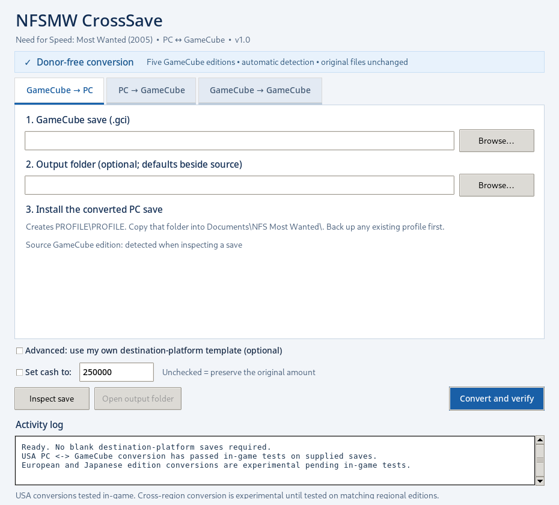
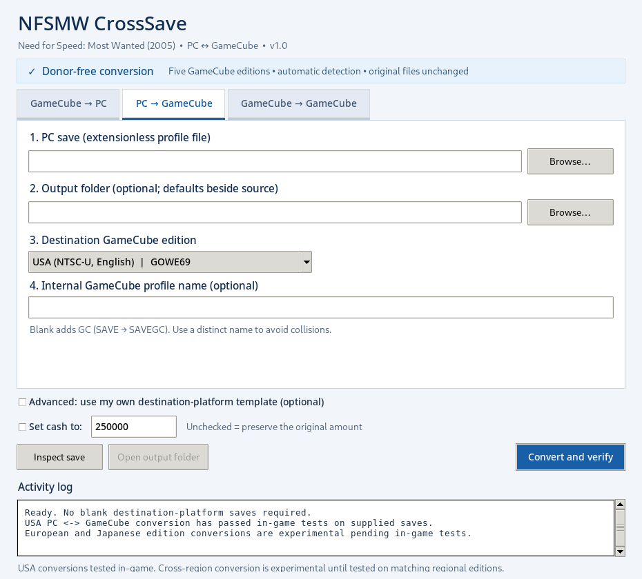
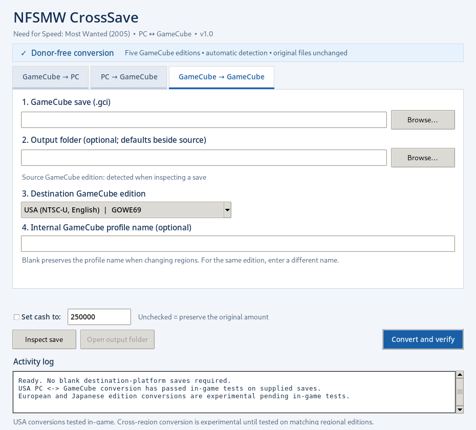

# NFSMW CrossSave v0.7.3

A Windows GUI utility for **Need for Speed: Most Wanted (2005)** save conversion between PC, GameCube, and experimental PS2 Black Edition (SLUS-21351).

**Current compatibility:** PC ↔ USA GameCube remains the only in-game-tested conversion. PS2 Black Edition conversion and other GameCube editions are **experimental**, validated structurally and by offline round-trip tests, not in-game. Back up your original saves.

## v0.7.3: PS2 destination-save selector fix

v0.7.2 required a destination save template for PS2 output, but incorrectly displayed a disabled Advanced checkbox and an error asking you to uncheck it. v0.7.3 replaces that contradiction with a **visible, required destination-save picker** and format-specific instructions. The template is verified against the selected output format before conversion. You may also **Inspect save** without a destination template; conversion still requires one.

**GameCube → Vita (extensionless output):** select **GameCube → PS2**, open your GameCube .gci as the source, select **Vita port profile (extensionless)**, then click **Browse destination save** and choose a genuine raw profile from the Vita port (for example EF, 62,669 bytes). Click **Convert and verify** to produce an extensionless output named after your GameCube career.

**GameCube → PS2 importer:** select **PS2 PSU archive**, and choose a genuine exported BASLUS-21351-*.psu as the destination save. The output .psu can be imported by the Vita port 1.3.7 from ux0:data/nfsmw/save/. Do not use a generated v0.7.0/0.7.1 PS2 file as the template.

**Important:** The genuine destination template requirement remains because unknown platform-only fields cannot yet be safely synthesized. The PS2/Vita conversion has passed structural regression tests but remains unverified in-game.

## Critical PS2/Vita serialization fix in v0.7.2

**The source is a GameCube .gci save; the destination is the Vita port's PS2 Black Edition format.** CrossSave v0.7.0 and v0.7.1 could generate structurally checksummed but in-game corrupt PS2 files because the native PS2 garage, customization and pursuit sections are at GameCube-aligned offsets, shifted +0x3C relative to PC. Vita raw profiles use PC-aligned data offsets plus a 20-byte-shorter header. This release explicitly maps these layouts rather than copying them interchangeably.

**PS2 output now requires an existing genuine destination-format save as its Advanced template.** The app enables the selector automatically. Choose:
- **Vita port profile:** an extensionless 62,669-byte profile created by the Vita port (e.g. EF)
- **PS2 game file:** a genuine 62,689-byte BASLUS-21351-* game file or a complete .psu export from Vita 1.3.7
- **PS2 PSU archive:** a complete .psu export (preserves metadata and icon), not just the raw PS2 file

No private save files or copyrighted PS2 console artwork are included in the application. For the Vita port's 1.3.7 PS2 importer, place native game files or .psu exports under ux0:data/nfsmw/save/ and restart the game. Existing imported profiles under the active save folder may conflict with the new name; back them up before import.

**GameCube → PC and GameCube regional transfers remain in place.** PS2 output remains experimental pending in-game feedback. Never overwrite your only copy of a save.

## Earlier v0.7.1 changes

The preceding release corrected fixed PC/PS2 padding sentinels and checksum handling, but it did not fix the native offset mismatch; v0.7.1 PS2 outputs should be regenerated with v0.7.2.

## What's new since v0.5

- All three v0.5 modes remain available: **GameCube → PC**, **PC → GameCube**, and **GameCube → GameCube** (regional edition transfer).
- Four new modes in the **same original blue-and-white GUI**: **PS2 → PC**, **PC → PS2**, **PS2 → GameCube**, **GameCube → PS2**.
- Accepts PS2 Black Edition saves from the latest Vita port (extensionless 62,669-byte profiles such as EF), native PS2 20CM files (62,689 bytes), and exported .psu memory-card archives (containing BASLUS-21351-PROFILE).
- PS2 output formats: **Vita raw** (PROFILE), **PS2 memory-card game file** (BASLUS-21351-PROFILE), or complete **PSU archive** (.psu).
- **All PS2 output requires a user-provided save of the matching destination format.** The Advanced template selector is enabled automatically. PSU export requires a complete PS2 Black Edition .psu template to preserve its memory-card icon and metadata.
- Automatic source inspection, cash editing, corruption checks, original-file preservation, and timestamped backups remain.
- No personal save files or copyrighted PS2 icon assets are bundled.

### Downloads

- **[Experimental v0.7.3 Windows EXE](https://github.com/ChatProductions/NFSMW-CrossSave/releases/tag/v0.7.3)**: NFSMW-CrossSave-v0.7.3.exe. Native/Vita layout correction; published after the Windows Actions build passes.
- **[In-game-tested v0.5.0 Windows EXE](https://github.com/ChatProductions/NFSMW-CrossSave/releases/tag/v0.5.0)**: NFSMW-CrossSave-v0.5.exe (PC ↔ USA GameCube).

### PS2 instructions

1. Choose the conversion direction, such as **PS2 → PC** or **PC → PS2**.
2. For **PS2 input**, browse to the Vita raw profile, native BASLUS-21351-* game file, or .psu export.
3. For **PS2 output**, select the format. Vita saves are extensionless; PS2 .psu needs the original PS2 archive supplied under *Advanced*.
4. Click **Inspect save**, then **Convert and verify**. Back up the source file before importing the generated save in a game.
5. For PC output, install the generated PROFILE\PROFILE inside Documents\NFS Most Wanted\. For GameCube output, import the generated .gci in Dolphin's matching regional memory card.

**Limitations:** PS2 Black Edition uses the US SLUS-21351 save title identity. Other PS2 editions are not supported. Structural tests do not demonstrate that the game will load a converted career; verify in-game using copies.

---

## Previous v0.5 documentation (still applicable to PC and GameCube)

# NFSMW CrossSave v0.5

A Windows GUI utility for **Need for Speed: Most Wanted (2005)** save conversion between PC and GameCube, with an experimental GameCube regional-edition converter.

**Compatibility status:** We tested PC ↔ USA GameCube (`GOWE69`) conversions in-game using real career saves. Other GameCube editions are awaiting user testing and feedback. The converter passes offline structural and checksum checks for the listed editions, but we have not yet verified their in-game compatibility.

## What's included in v0.5

- Added a third mode: **GameCube → GameCube** for changing the target edition.
- Automatic source GameCube game ID detection when browsing or inspecting saves.
- GameCube edition selector for **PC → GameCube** and **GameCube → GameCube**.
- Preserves the **GameCube-native career payload byte-for-byte** during a region-only change, unless you explicitly edit the profile name or cash.
- Rebuilds GCI directory identity, banner/comment prelude and media checksum for the chosen target game ID.
- GameCube output names include the destination game ID, e.g. `SAVE-GOWP69-converted.gci`.
- Checks for conflicting GameCube identities in the destination folder using **both game ID and internal filename**, rather than Windows filenames.
- Preserves the established blue-and-white GUI, donor-free conversion, cash override, automatic backups, and Windows EXE build script.

## Recognized GameCube editions

| Edition | Game ID | Status |
|---|---|---|
| USA / English | `GOWE69` | **In-game tested** with PC ↔ GC career saves |
| PAL / English | `GOWP69` | **Awaiting user testing** |
| PAL / German | `GOWD69` | **Awaiting user testing** |
| PAL / French | `GOWF69` | **Awaiting user testing** |
| Japan / Japanese | `GOWJ13` | **Awaiting user testing** |

These five editions are currently selectable. Dolphin also lists **`GOWJ69`**, another **Japanese** GameCube identifier alongside `GOWJ13`. We have not examined a genuine `GOWJ69` save, so the converter does not yet support that ID. **This does not mean it is incompatible.** Support can be reconsidered after users provide matching save samples or compatibility reports.

## Download

Download the standalone Windows application from **[GitHub Releases](https://github.com/ChatProductions/NFSMW-CrossSave/releases/latest)**. Under **Assets**, select `NFSMW-CrossSave-v0.5.exe`. You do not need Python to run it.

For development builds, see the [GitHub Actions page](https://github.com/ChatProductions/NFSMW-CrossSave/actions).

### Screenshots

## Using the Windows EXE

1. Open the [v0.5.0 release](https://github.com/ChatProductions/NFSMW-CrossSave/releases/tag/v0.5.0) and download `NFSMW-CrossSave-v0.5.exe` under **Assets**.
2. Run the downloaded `.exe` on Windows. No Python installation or source-code ZIP is needed.
3. Choose **GameCube → PC**, **PC → GameCube**, or **GameCube → GameCube**.
4. Select the input save. For GameCube output, select the destination edition and optionally set a different internal profile name.
5. Click **Inspect save**, then **Convert and verify**.
6. Before importing, **create a ZIP archive of your original save files** and keep it somewhere safe. Also back up your complete Dolphin memory card (or GCI save folder). Test regional conversions on a copy.

Windows may show a SmartScreen warning because this independent application is not code-signed. Only run the executable if you trust its source.

### The three modes

**GameCube → PC:** Select an exported `.gci` file. The program detects its game ID and creates `PROFILE\PROFILE` for `Documents\NFS Most Wanted\`. Source GameCube editions other than USA are untested in-game.

**PC → GameCube:** Select the extensionless PC profile file (e.g. `Documents\NFS Most Wanted\SAVE\SAVE`), choose the target GameCube edition. By default, the internal profile is suffixed with `GC` (example `SAVE → SAVEGC`) to avoid collisions. You can supply a different name.

**GameCube → GameCube:** Select the source `.gci`, then choose the target edition. The internal profile name is **preserved by default** across regions. To create another save for the *same* edition, supply a different internal profile name. A region-only conversion leaves the embedded MC02 career block unchanged; it changes the surrounding GCI metadata, not the in-game language.

## Back up your original saves

**Make a ZIP backup before converting or importing anything.** The converter preserves the selected input save, but importing a converted save into Dolphin can conflict with an existing one.

1. Close the game in Dolphin.
2. For a **GameCube save**, export your existing save as a `.gci` from Dolphin's Memory Card Manager, or copy the original `.gci` from your GCI Folder.
3. For a **PC save**, copy the entire profile folder from `Documents\NFS Most Wanted\`.
4. In Windows File Explorer, select the copied files or folders, right-click and choose **Compress to ZIP file** (or **Send to → Compressed (zipped) folder** on some versions).
5. Keep the ZIP away from your converted files. If you use Dolphin's `.raw` memory card, also back up the entire `.raw` file.

## Importing a converted save into Dolphin

Check **Config → GameCube → Slot A** (or Slot B) to see whether Dolphin uses a **Memory Card** (`.raw`) or **GCI Folder**. Use the slot and region your game actually uses.

### Memory Card (.raw)

1. Close the running game.
2. Open **Tools → Memory Card Manager (GC)** in Dolphin (the menu wording may vary by version).
3. Open the correct region's `.raw` memory card under **Slot A** or **Slot B**. Create one if necessary.
4. Click **Import…** and choose the converted `.gci`.
5. Confirm that the save appears on the card, then launch the matching regional game.

### GCI Folder

1. Close the running game. In Dolphin, choose **File → Open User Folder**.
2. Go to the matching region and slot folder:

   - USA: `GC/USA/Card A/`
   - Europe (PAL): `GC/EUR/Card A/`
   - Japan: `GC/JAP/Card A/`

   If you use Slot B, select `Card B` instead.
3. Copy the converted `.gci` into that folder. After creating your ZIP backup, move any conflicting original save out of the active folder. Different Windows filenames can still have the same internal GameCube save identity.
4. Launch the matching regional edition and check whether the career loads.

**Do not place a `.gci` inside a `.raw` file manually.** Use Memory Card Manager to import it. For **GameCube → PC**, install the generated `PROFILE\PROFILE` folder under `Documents\NFS Most Wanted\`; Dolphin is not involved.

## Building the program

These steps are for people who want to run the source code or compile their own Windows executable.

1. Install **Python 3.10 or newer** on Windows.
2. Clone this repository or download and extract its source ZIP.
3. To run from source, double-click `Start Converter.bat`.
4. To compile a standalone EXE, double-click `Build Windows EXE.bat` (or run `Build Windows EXE.ps1`). The build script installs PyInstaller and produces `dist\NFSMW-CrossSave-v0.5.exe`.

GitHub Actions also builds the Windows executable automatically from the repository source.

## Validation and limitations

- PC ↔ USA GameCube: We tested both directions in-game using real career saves; other saves may vary.
- Five GameCube game IDs: wrapper structure and checksums tested offline; **PAL and Japanese editions await user testing and feedback**.
- GameCube → GameCube: verified that a region-only transfer preserves the complete embedded career block and that the new GCI passes structural checks. We are awaiting user reports to verify whether each regional game loads the converted save.
- Japanese-language profile names with non-ASCII characters are **not supported**. The program will reject unsupported name encodings instead of silently corrupting them.
- Expects an exported `.gci`, not a raw `.raw` memory card image, `.sav`, PS2 or Xbox save.
- The built-in GameCube banner/icon is a generic replacement. Regional banner and localization-specific metadata may differ from original regional saves.
- Source files are never edited. If the selected output path already exists, the app requests confirmation and writes a timestamped backup before replacing it.
- The app verifies checksums, names, and wrapper structure; it cannot verify that a particular game's career menu or garage will load without an in-game test.

## Testing

`python self_test.py` runs the scaffold sanity checks. For fixture-based tests:

`python self_test.py original_USA.gci known_good_PC broken_v02.gci`

`python test_regions.py original_USA.gci known_good_PC`

The regional suite checks all five game IDs, GC → GC → GC round-trips, PC → GC → PC conversion, preservation of native career data, and rejection of unsupported IDs/corrupt saves. **No personal saves are bundled.**

## References

- [Dolphin Emulator Wiki: Need for Speed: Most Wanted](https://wiki.dolphin-emu.org/forum/Need%20for%20Speed%3A%20Most%20Wanted/embed)
- [GameTDB GameCube edition IDs](https://www.gametdb.com/Wii/List?p=29&q=)
- [dbalatoni13/nfsmw](https://github.com/dbalatoni13/nfsmw) (reverse-engineered save structures)
- [sprintstate/nfs-mw-save-editor](https://github.com/sprintstate/nfs-mw-save-editor)

Independent fan-made research utility. Not affiliated with or endorsed by Electronic Arts or Nintendo.